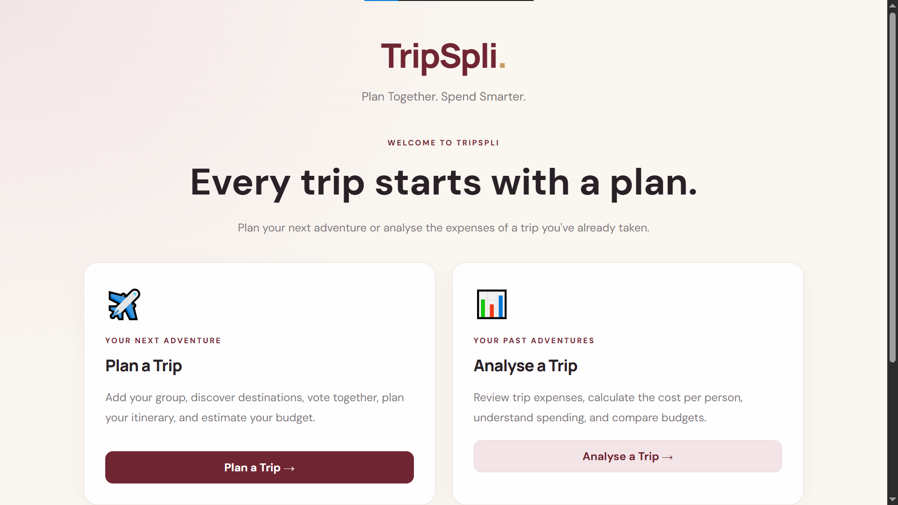
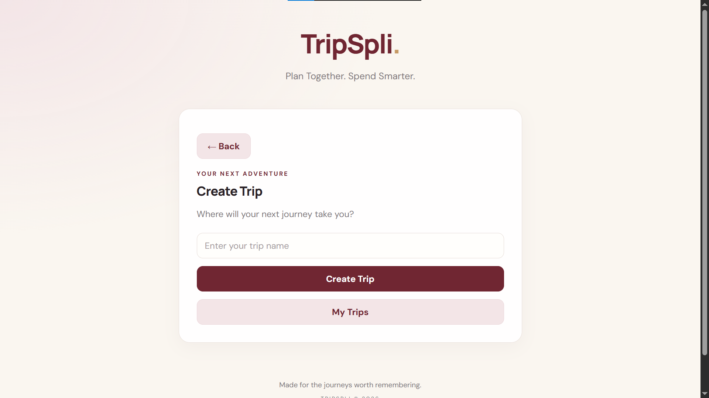
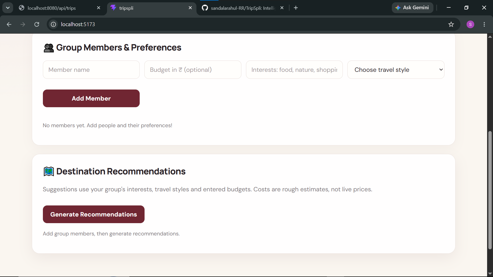
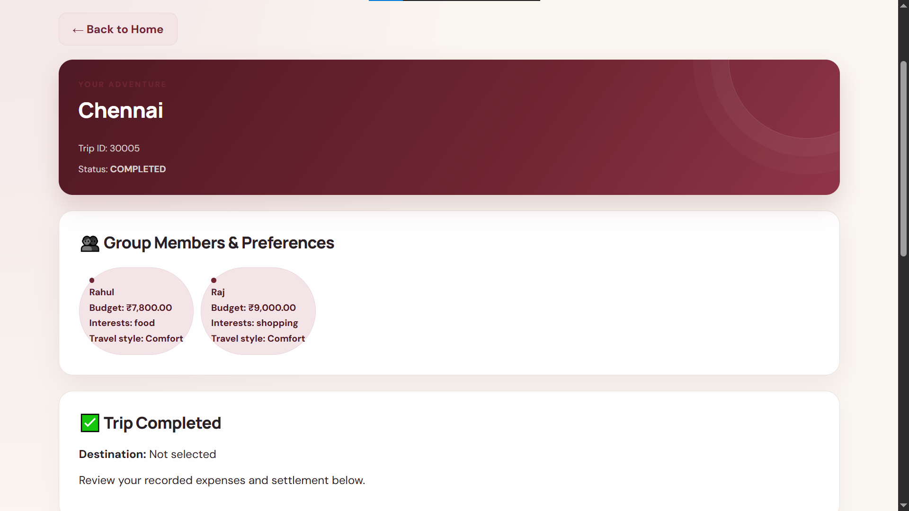

TripSpli ✈️
      - Plan Together. Spend Smarter. Remember Forever.

TripSpli is an intelligent group trip planner designed to simplify travel planning, budget management, expense tracking, and settlement among friends and groups.

  ✨ Features

- 🧳 Trip Planning:** Create and organize group trips.
- 👥 Group Management:** Add members and record their budgets, interests, and travel preferences.
- 🌍 Destination Recommendations:** Explore destination options based on group preferences.
- 🗳️ Group Voting:** Vote on destinations and make decisions together.
- 💰 Expense Tracking:** Record and manage trip expenses.
- 📊 Budget Summary:** Review trip expenses and costs.
- 🤝 Expense Settlement:** Calculate balances and simplify payments between group members.
- 📅 Trip Lifecycle:** Manage trips from planning to active travel and completion.

## 🛠️ Technologies Used

### Frontend
- React
- Vite
- JavaScript
- Axios
- CSS

### Backend
- Java
- Spring Boot
- Spring Data JPA
- Maven

### Database
- TiDB Cloud

## 📁 Project Structure

```text
TripSpli/
├── frontend/
│   ├── public/
│   ├── src/
│   ├── package.json
│   └── vite.config.js
├── backend/
│   ├── src/
│   ├── pom.xml
│   └── mvnw
└── .gitignore

## 📸 Screenshots

### Homepage


### Create Trip


### Destination Recommendations


### Trip Details

